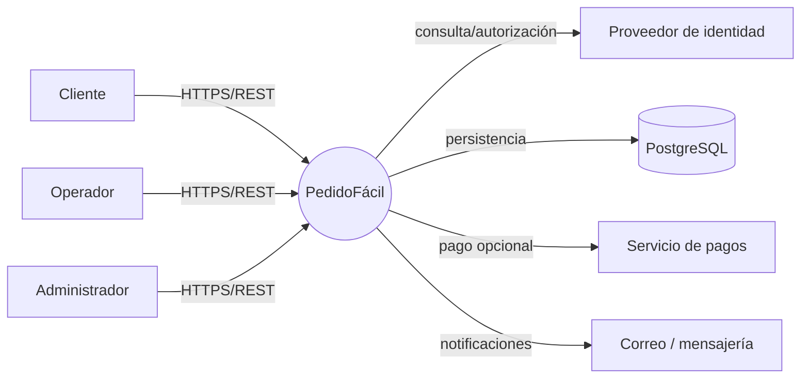
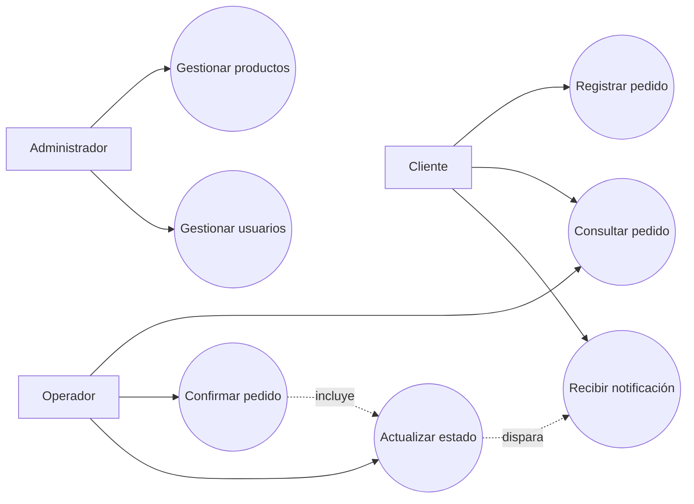
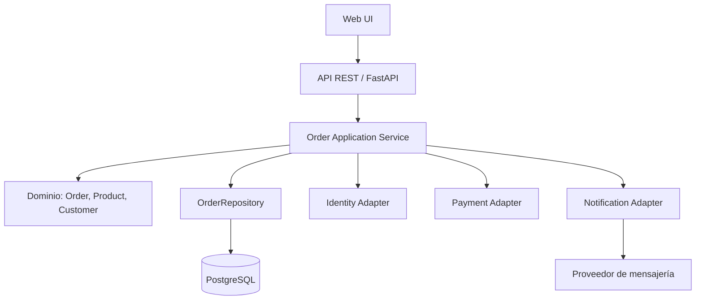
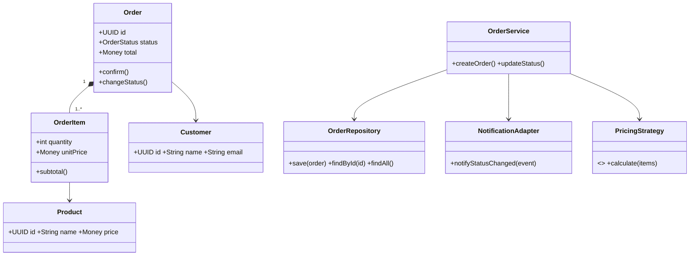
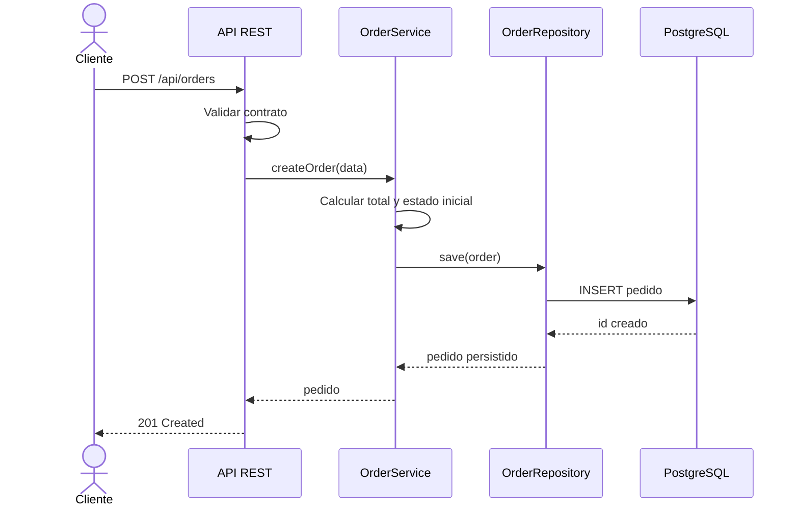
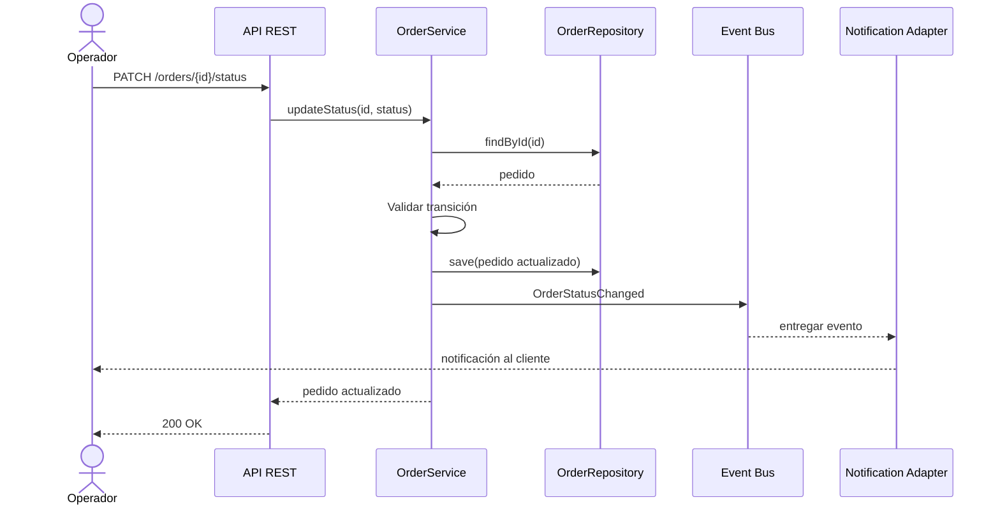
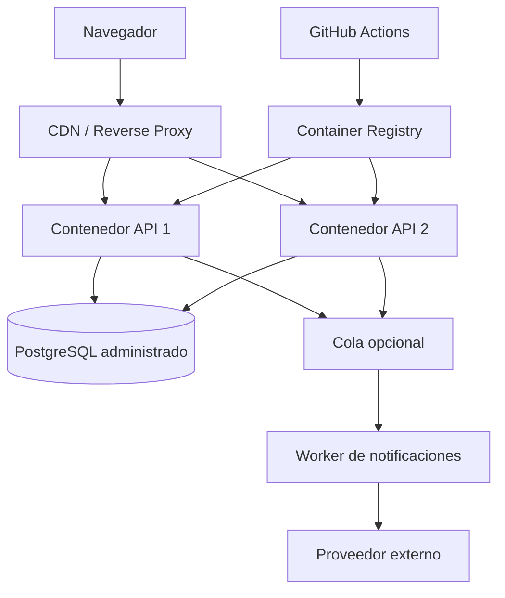
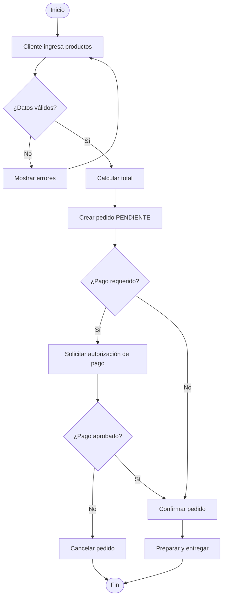
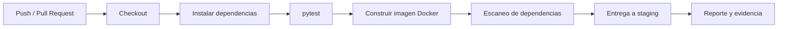

# Diagramas completos — PedidoFácil

Este archivo reúne todos los diagramas del proyecto. Cada sección contiene un diagrama Mermaid independiente.

## 1. Diagrama de contexto

## 2. Diagrama de casos de uso

## 3. Diagrama de componentes

## 4. Diagrama de clases

## 5. Diagrama de secuencia: crear pedido

## 6. Diagrama de secuencia: cambio de estado

## 7. Diagrama de despliegue

## 8. Diagrama de actividad: proceso de pedido

## 9. Diagrama del pipeline CI/CD

